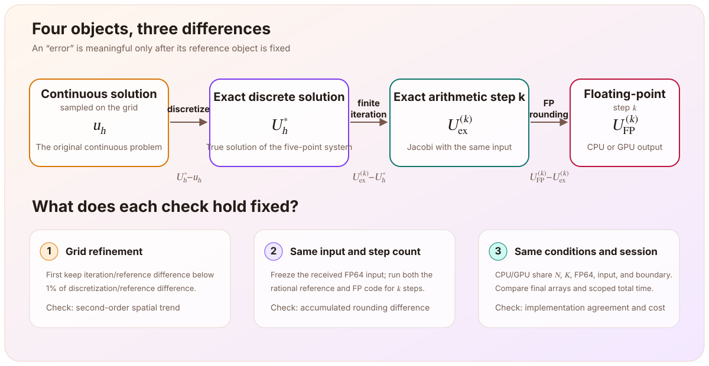

> This article is based on the fifth stage (M5, back to the continuous equation) of the [Poisson equation learning thread](/en/notes/systems/poisson-equation/). The [previous article](/en/notes/systems/poisson-equation/cuda-jacobi-consistency/) established that, over a finite test range, the CPU and CUDA implementations reproduce the same Jacobi iteration. This stage asks the next questions: how far is that common array from the solution of the continuous equation, where does the distance come from, and how much time did it take to obtain? I implemented the error measurements and the exact-rational Jacobi step. The Jacobi solves reuse the CPU and CUDA cores that I implemented in M3 and M4. The assistant supplied the experiment driver, timing framework, archive, and plots; I ran the GPU experiment in Colab and retrieved the results. The corresponding learning-repository tag is `milestone-05-validation`.

# CPU and GPU

M4 concluded that, with the same grid, initial state, source, precision, and fixed iteration count, the CPU and GPU results agree within the chosen tolerance. That answers whether the two programs execute the same discrete iteration. It does not answer whether either result is already close to the true solution of the continuous equation.

Even if

$$
U_{\mathrm{CPU}}^{(k)}=U_{\mathrm{GPU}}^{(k)},
$$

both sides may still contain:

- bias from replacing the continuous differential equation with a five-point difference equation;
- error because Jacobi has run for only finitely many iterations and has not yet reached the discrete solution;
- error accumulated by floating-point arithmetic relative to exact arithmetic.

The final stage therefore cannot stop at another CPU/GPU comparison. It must connect the computed result back to the continuous equation.

# Four objects and three differences

To make the word *error* precise, first distinguish four objects:

| Symbol | Object |
|---|---|
| $u_h$ | Samples of the exact continuous solution $u$ at the grid points |
| $U_h^*$ | The exact-arithmetic solution of the five-point discrete equation, the same $U^*$ used in M3; the subscript $h$ identifies the grid |
| $U_{\mathrm{ex}}^{(k)}$ | The result after $k$ exact-arithmetic Jacobi iterations on the same discrete input |
| $U_{\mathrm{FP}}^{(k)}$ | The result actually produced after $k$ floating-point Jacobi iterations |

They satisfy the pointwise identity

$$
\boxed{
\begin{aligned}
U_{\mathrm{FP}}^{(k)}-u_h
&=
\underbrace{U_h^*-u_h}_{\text{discretization error}}
+\underbrace{U_{\mathrm{ex}}^{(k)}-U_h^*}_{\text{exact-arithmetic iteration error}}\\
&\quad
+\underbrace{U_{\mathrm{FP}}^{(k)}-U_{\mathrm{ex}}^{(k)}}_{\text{accumulated rounding difference}}.
\end{aligned}
}
$$

This identity also determines the reference for each comparison:

- discretization error compares $U_h^*$ with $u_h$;
- iteration error compares iteration $k$ of one discrete problem with its discrete solution;
- rounding difference compares floating-point and exact arithmetic with the same input and iteration count.

Changing either the reference object or the iteration count mixes these effects again.

The discrete reference for the three practical grid sizes is evaluated from a `float64` formula, so it is denoted by $U_{\mathrm{ref}}$ below. The measured $E_{\mathrm{iter/ref}}$ and $E_{\mathrm{disc/ref}}$ are therefore differences relative to a finite-precision reference. They are not rigorously isolated exact-arithmetic errors. A separate small experiment provides the exact rounding comparison.

# Choose a two-dimensional problem whose answer is known

To measure error against the continuous equation, consider the unit-square problem

$$
-\Delta u
=5\pi^2\sin(\pi x)\sin(2\pi y),
\qquad
u|_{\partial\Omega}=0.
$$

Because

$$
-\Delta\bigl[\sin(\pi x)\sin(2\pi y)\bigr]
=(\pi^2+4\pi^2)\sin(\pi x)\sin(2\pi y),
$$

the exact continuous solution is

$$
u(x,y)=\sin(\pi x)\sin(2\pi y).
$$

It satisfies the zero boundary condition and is a sine mode of both the continuous and discrete operators. The discrete solution can therefore be written as the same shape with a corrected amplitude. The eigenvalue of the five-point negative Laplacian for this mode is

$$
\lambda_h
=\frac{4}{h^2}
\left[
\sin^2\left(\frac{\pi h}{2}\right)
+\sin^2(\pi h)
\right],
$$

so the discrete solution on the grid is

$$
U_h^*
=\frac{5\pi^2}{\lambda_h}u_h.
$$

Expanding the discrete eigenvalue gives the leading amplitude error:

$$
\frac{5\pi^2}{\lambda_h}-1
=\frac{17\pi^2}{60}h^2+O(h^4).
$$

This gives a prediction that can be checked directly: halving $h$ should reduce the leading discretization error by approximately a factor of four.

# Suppress iteration error before observing discretization error

If Jacobi stops too early, the total error mainly measures incomplete iteration, and the second-order trend under grid refinement may be hidden. The experiment therefore sets the budget

$$
E_{\mathrm{iter/ref}}
\le 0.01E_{\mathrm{disc/ref}},
$$

where

$$
\begin{aligned}
E_{\mathrm{total}}
&=\|U_{\mathrm{FP}}^{(K)}-u_h\|_\infty,\\
E_{\mathrm{iter/ref}}
&=\|U_{\mathrm{FP}}^{(K)}-U_{\mathrm{ref}}\|_\infty,\\
E_{\mathrm{disc/ref}}
&=\|U_{\mathrm{ref}}-u_h\|_\infty.
\end{aligned}
$$

$E_{\mathrm{iter/ref}}$ has the same definition as the deviation $D_k$ in M3, evaluated at $k=K$. The difference is that $U_{\mathrm{ref}}$ is now evaluated from the closed-form expression above in `float64`, rather than obtained by solving the linear system directly. The error-family notation makes its relation to the total and discretization errors explicit.

The three grids use

$$
(N,K)=(16,256),(32,1024),(64,4096).
$$

With a zero initial state and a source containing only the $(1,2)$ mode, the exact-arithmetic iteration error also contains only this mode. Each Jacobi step multiplies it by the M3 factor

$$
g_{1,2}=\frac{\cos(\pi h)+\cos(2\pi h)}{2}.
$$

Its expansion is $-\ln g_{1,2}=\frac{5\pi^2}{4}h^2+O(h^4)$, so, like the slowest mode, its decay rate tends to zero as $h^2$. All three runs use $K=N^2=h^{-2}$. Consequently, $g_{1,2}^K$ stays approximately constant and tends to $e^{-5\pi^2/4}\approx4.4\times10^{-6}$ as $h\to0$. These are fixed iteration counts selected in advance and checked against the budget; they are not the first passing counts found by testing every iteration.

# Results on three grids

| $N$ | $K$ | $E_{\mathrm{total}}$ | $E_{\mathrm{iter/ref}}/E_{\mathrm{disc/ref}}$ | coarse/fine total-error ratio |
|---:|---:|---:|---:|---:|
| 16 | 256 | $1.098555985\times10^{-2}$ | $0.03417\%$ | — |
| 32 | 1024 | $2.730732551\times10^{-3}$ | $0.15438\%$ | $4.022935$ |
| 64 | 4096 | $6.786234338\times10^{-4}$ | $0.63619\%$ | $4.023929$ |

Both total-error refinement ratios are about 4.02, and the iteration-to-reference difference remains below the 1% budget on all three grids. The corresponding ratios computed from the discretization-to-reference difference alone are 4.018097 and 4.004512, which follow the second-order prediction even more directly.

The schedule keeps the absolute iteration error approximately constant, rather than its ratio to the discretization error. Across the three grids, $g_{1,2}^K$ stays between $3.7\times10^{-6}$ and $4.3\times10^{-6}$, while the discretization error decreases as $h^2$. The iteration share therefore grows by about a factor of four at each refinement, as seen in 0.034%, 0.154%, and 0.636%. Reusing the same schedule at $N=128$ and $K=16384$ would give a predicted exact-arithmetic share of about 2.6%, exceeding the 1% budget. Beyond that point, $K$ must grow faster than $h^{-2}$.

These results support a second-order trend for this smooth sine mode on these three grids. Three data points do not replace a general convergence proof, and the finite-precision reference still has rounding error of its own.

# Total error is not the sum of two error magnitudes

The error identity adds signed vectors. After taking norms, only a triangle inequality generally remains; two nonnegative error magnitudes cannot simply be added.

For example, with $N=64$ and $K=4096$, at $(x,y)=(0.5,0.25)$:

| Object | Value |
|---|---:|
| Continuous reference $u_h$ | $1$ |
| Discrete reference $U_{\mathrm{ref}}$ | $1.0006829683937724$ |
| Current iterate $U_{\mathrm{FP}}^{(K)}$ | $1.0006786234337672$ |

The discrete reference is about $6.83\times10^{-4}$ above the continuous solution, while the current iterate is about $4.34\times10^{-6}$ below the discrete reference. The two signed terms point in opposite directions, so their sum is about $6.79\times10^{-4}$, slightly smaller than the discretization-to-reference difference.

This cancellation does not require a rounding explanation. Starting from zero, single-mode Jacobi approaches the discrete amplitude from below. When the current amplitude lies between the continuous amplitude $1$ and the discrete amplitude, the iteration and discretization differences naturally have opposite signs.

# How can rounding be observed separately?

Comparing floating-point iteration $k$ directly with the discrete solution mixes rounding with incomplete iteration. To cancel the latter, a second path must execute exactly the same $k$ iterations on the same input while changing only the arithmetic rules:

$$
\begin{aligned}
U_{\mathrm{FP}}^{(k)}-U_{\mathrm{ex}}^{(k)}
&=\bigl(U_{\mathrm{FP}}^{(k)}-U_h^*\bigr)\\
&\quad-\bigl(U_{\mathrm{ex}}^{(k)}-U_h^*\bigr).
\end{aligned}
$$

The experiment fixes $N=8$, a zero initial state, and $h^2=1/64$. It freezes the FP64 source values actually received by the program as exact rational numbers, then runs the floating-point C++ implementation and a `Fraction` implementation for the same iteration count. The comparison is

$$
E_{\mathrm{round}}^{(k)}
=\max_{i,j}
\left|
\operatorname{Fraction}\bigl(U_{\mathrm{FP},ij}^{(k)}\bigr)
-U_{\mathrm{ex},ij}^{(k)}
\right|.
$$

| $k$ | Maximum accumulated rounding difference $E_{\mathrm{round}}^{(k)}$ |
|---:|---:|
| 0 | $0$ |
| 1 | $0$ |
| 2 | $2.77555756\times10^{-17}$ |
| 4 | $6.23175144\times10^{-17}$ |
| 8 | $1.33830645\times10^{-16}$ |
| 16 | $1.23560996\times10^{-16}$ |
| 32 | $2.00109449\times10^{-16}$ |
| 64 | $2.18241710\times10^{-16}$ |

The first iteration begins from zero and only multiplies the already represented source by $1/256$, which is exactly representable in binary, so the two paths are still exactly equal for these data. The maximum difference decreases from iteration 8 to iteration 16. This is enough to show that accumulated rounding difference cannot be assumed to increase monotonically with the iteration count.

This conclusion is limited to the frozen input, $N=8$, at most 64 iterations, and the current CPU compiler configuration. It does not isolate rounding in the thousands of GPU iterations used by the three larger runs.

# CPU and GPU accuracy results

For each of the three final runs, the CPU and GPU receive the same FP64 input, boundary values, and fixed iteration count. Each path is called once as a warm-up, then measured six times, with the execution order alternating. The maximum array difference is zero for all 18 measured CPU/GPU pairs, and the complete final arrays saved for all three grid sizes are equal point by point.

The two implementations therefore produce exactly the same $E_{\mathrm{total}}$, and their error points coincide in the plot. This establishes floating-point output agreement under the current conditions. It does not establish that:

- the arrays equal the exact continuous solution;
- CPU and GPU will be bitwise equal for every input;
- the rational rounding experiment above covers the GPU computation;
- the program uses an optimal GPU implementation.

M4 found last-bit differences at $N=34$ and listed fused multiply-add behavior as a hypothesis to test. This run uses a different GPU (T4), compiler (`nvcc 13.0`), and input (one sine mode), and it produces bitwise-equal results. That shows that the last-bit difference depends on the specific conditions. It does not test the M4 hypothesis, and the source of that difference remains unidentified.

# “How long did it take?” requires a defined scope

The final timing run used one Colab instance with a Tesla T4, 15360 MiB, driver 580.82.07, `nvcc 13.0.88`, host `g++ 13.3.0`, and two logical CPUs exposed by the system. The three grid sizes ran sequentially in one solver process. Each CPU and GPU path had one warm-up call and six measured calls, with the order alternating.

The primary `total` metric includes:

- preparation of the work buffers for the measured task;
- host-to-device upload and device-to-host download for the GPU;
- the fixed number of iterations.

It excludes initial device setup, synchronization before the timer, deallocation, numerical checks, and printing. The GPU `iterate` region still includes one kernel launch, status check, and `cudaDeviceSynchronize()` per iteration, so it is not a pure kernel-execution measurement.

| $N,K$ | CPU total median ms [min, max] | GPU total median ms [min, max] |
|---|---:|---:|
| 16, 256 | $0.066177$ [$0.065119$, $0.070126$] | $2.804657$ [$2.759705$, $2.936807$] |
| 32, 1024 | $1.233040$ [$1.118377$, $1.363217$] | $10.790271$ [$10.298605$, $11.112569$] |
| 64, 4096 | $19.109574$ [$18.604811$, $20.067575$] | $42.357527$ [$41.404354$, $50.150406$] |

The GPU `total` medians are approximately 42.4, 8.75, and 2.22 times the CPU medians. The GPU is slower in this experiment. That is a valid result, rather than a failed test.

# Does a slower GPU invalidate the second-order error result?

No. In this experiment, the discrete scheme, $N$, $K$, precision, initial state, source, and boundary values are fixed, and the CPU/GPU arrays are equal point by point. Runtime changes the cost of obtaining the result; it does not change the measured error values or refinement ratios.

The separation of accuracy and time has conditions. Under a fixed time budget, a slower implementation completes fewer iterations, so performance affects the final error through $K$. Changing precision, the stopping rule, or the numerical scheme for speed also changes accuracy.

The data do not establish that GPUs are generally slower:

- per-iteration synchronization forces many short kernels to wait serially;
- both the grid and the iteration count increase, so the three rows are not a controlled experiment that varies only $N$;
- the experiment uses one T4, one session, and six measured samples per item;
- host-device transfers are included in total cost;
- no bottleneck has been isolated, and no larger crossover point has been sought.

# Summary

| Part | Result obtained | Current boundary |
|---|---|---|
| Error language | Separates continuous samples, the discrete solution, exact-arithmetic iteration, and floating-point iteration | The discrete reference in the three-grid experiment is still generated by a finite-precision formula |
| Grid validation | Total-error refinement ratios are about 4.02 for $N=16,32,64$, supporting a second-order trend for this mode | A three-grid smooth-mode experiment is not a general convergence proof |
| Iteration control | The iteration-to-reference difference remains below 1% of the discretization-to-reference difference on all three grids | Fixed counts, not first-passing counts found by checking every step; the share grows by about four at each refinement and exceeds the budget at $N=128$ under the current schedule |
| Rounding comparison | For $N=8$ and $k\le64$, the accumulated CPU rounding difference remains below $2.2\times10^{-16}$ and is not monotone in $k$ | Does not cover thousands of GPU iterations on the three larger grids |
| CPU/GPU accuracy | All measured pairs and final arrays on the three grids are equal point by point | Cannot be generalized to bitwise equality across arbitrary platforms and inputs |
| Computational cost | GPU total time exceeds CPU total time at all three measured sizes for the current T4 implementation | Not a general performance conclusion; the bottleneck has not been isolated |

From M1 through M5, the complete thread now closes as

$$
\boxed{
\begin{aligned}
&\text{energy and weak form}
\longrightarrow
\text{Poisson equation and uniqueness}\\
&\longrightarrow
\text{discrete energy and the five-point stencil}
\longrightarrow
\text{Jacobi on CPU and CUDA}\\
&\longrightarrow
\text{practical checks of the continuous reference, error decomposition, and computational cost}.
\end{aligned}
}
$$

M5 turns “the program produced an array” into a result that can be questioned layer by layer: which discrete problem it solves, how far the iteration has progressed, how much floating-point arithmetic changes it, and how much time the current implementation spends to obtain it.
