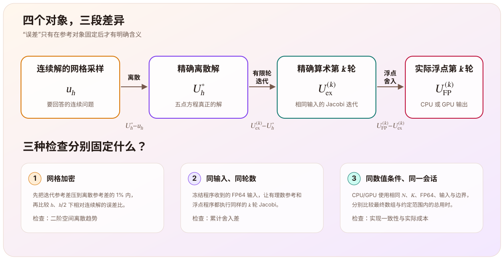
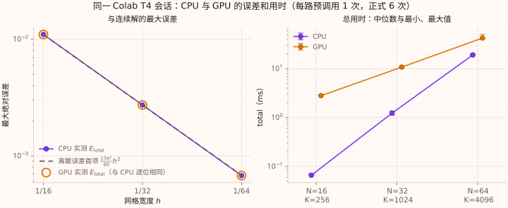

> 这篇文章根据[泊松方程学习主线](/notes/systems/poisson-equation/)第五阶段（M5，回到连续方程）的记录整理。[上一篇](/notes/systems/poisson-equation/cuda-jacobi-consistency/)已经确认，在有限测试范围内，CPU 与 CUDA 实现复现了同一个 Jacobi 迭代过程。本阶段继续追问：相同的数组离连续方程还有多远，这段距离来自哪里，得到它又花了多少时间。误差测量与有理数 Jacobi 单步核心由我实现，Jacobi 求解本身沿用 M3、M4 中我实现的 CPU 与 CUDA 核心；实验驱动、计时框架、归档和图表由助手提供；GPU 实验由我在 Colab 上运行并取回。对应学习仓库标签为 `milestone-05-validation`。

# CPU 和 GPU

M4 的结论是：在相同网格、初值、源项、精度和固定轮数下，CPU 与 GPU 的结果在既定容差内一致。这回答了两个程序是否执行了同一个离散迭代，却没有回答它们是否已经接近连续方程的真实解。

即使

$$
U_{\mathrm{CPU}}^{(k)}=U_{\mathrm{GPU}}^{(k)},
$$

两边也可能同时包含：

- 把连续微分方程换成五点差分方程造成的偏差；
- Jacobi 只执行有限轮、尚未到达离散解造成的偏差；
- 实际浮点运算相对精确算术积累的偏差。

所以最后一步不能只继续比较 CPU 和 GPU，而要重新把计算结果接回连续方程。

# 四个对象与三段差异

为了把“误差”说清楚，先区分四个对象：

| 记号 | 对象 |
|---|---|
| $u_h$ | 连续精确解 $u$ 在网格节点上的采样 |
| $U_h^*$ | 五点离散方程在精确算术下的解，即 M3 的 $U^*$，下标 $h$ 标明网格 |
| $U_{\mathrm{ex}}^{(k)}$ | 对同一离散输入执行 $k$ 轮精确算术 Jacobi 的结果 |
| $U_{\mathrm{FP}}^{(k)}$ | 程序实际执行 $k$ 轮浮点 Jacobi 的结果 |

它们满足逐点恒等式

$$
\boxed{
\begin{aligned}
U_{\mathrm{FP}}^{(k)}-u_h
&=
\underbrace{U_h^*-u_h}_{\text{离散误差}}
+\underbrace{U_{\mathrm{ex}}^{(k)}-U_h^*}_{\text{精确算术迭代误差}}\\
&\quad
+\underbrace{U_{\mathrm{FP}}^{(k)}-U_{\mathrm{ex}}^{(k)}}_{\text{累计舍入差}}.
\end{aligned}
}
$$

这个式子也规定了每类差异该和谁比较：

- 离散误差比较 $U_h^*$ 与 $u_h$；
- 迭代误差比较同一离散问题的第 $k$ 轮与离散解；
- 舍入差比较同一输入、同一轮数的浮点运算与精确算术。

如果参考对象或轮数不同，几种影响会重新混在一起。

实际三档网格实验使用的离散参考由 `float64` 公式计算，因此文中记作 $U_{\mathrm{ref}}$。相应的 $E_{\mathrm{iter/ref}}$ 和 $E_{\mathrm{disc/ref}}$ 是相对有限精度参考的测量，不能冒充已经严格隔离的精确算术误差；精确舍入对照另做一组小规模实验。

# 选择一个知道答案的二维问题

为了测连续误差，选取单位正方形上的问题

$$
-\Delta u
=5\pi^2\sin(\pi x)\sin(2\pi y),
\qquad
u|_{\partial\Omega}=0.
$$

因为

$$
-\Delta\bigl[\sin(\pi x)\sin(2\pi y)\bigr]
=(\pi^2+4\pi^2)\sin(\pi x)\sin(2\pi y),
$$

连续精确解就是

$$
u(x,y)=\sin(\pi x)\sin(2\pi y).
$$

它既满足零边界，又是连续和离散算子的正弦模态，因此可以把离散解写成一个幅度修正后的同形函数。五点负 Laplace 算子在这个模态上的离散特征值是

$$
\lambda_h
=\frac{4}{h^2}
\left[
\sin^2\left(\frac{\pi h}{2}\right)
+\sin^2(\pi h)
\right],
$$

于是网格上的离散解为

$$
U_h^*
=\frac{5\pi^2}{\lambda_h}u_h.
$$

展开离散特征值可得幅度误差的首项：

$$
\frac{5\pi^2}{\lambda_h}-1
=\frac{17\pi^2}{60}h^2+O(h^4).
$$

这给出了可以直接检查的预测：$h$ 减半以后，离散误差主项应缩小到约四分之一。

# 先压低迭代误差，再观察离散误差

如果 Jacobi 轮数太少，总误差主要反映“还没迭代够”，网格加密的二阶规律就可能被遮住。实验因此先设置预算

$$
E_{\mathrm{iter/ref}}
\le 0.01E_{\mathrm{disc/ref}},
$$

其中

$$
\begin{aligned}
E_{\mathrm{total}}
&=\|U_{\mathrm{FP}}^{(K)}-u_h\|_\infty,\\
E_{\mathrm{iter/ref}}
&=\|U_{\mathrm{FP}}^{(K)}-U_{\mathrm{ref}}\|_\infty,\\
E_{\mathrm{disc/ref}}
&=\|U_{\mathrm{ref}}-u_h\|_\infty.
\end{aligned}
$$

这里的 $E_{\mathrm{iter/ref}}$ 和 M3 的偏差 $D_k$ 定义相同（取 $k=K$），只是 $U_{\mathrm{ref}}$ 改由上面的闭式公式按 `float64` 计算，而不是直接求解线性系统；换用误差家族的记号，是为了和总误差、离散误差对照。

三档网格分别使用

$$
(N,K)=(16,256),(32,1024),(64,4096).
$$

零初值、源项只含 $(1,2)$ 一个模态时，精确算术下的迭代误差也只含这个模态，每轮乘以 M3 中的 Jacobi 倍率

$$
g_{1,2}=\frac{\cos(\pi h)+\cos(2\pi h)}{2}.
$$

展开得 $-\ln g_{1,2}=\frac{5\pi^2}{4}h^2+O(h^4)$，和最慢模态一样按 $h^2$ 趋于零。三档都取 $K=N^2=h^{-2}$，所以 $g_{1,2}^K$ 大致保持不变，并随 $h\to0$ 趋于 $e^{-5\pi^2/4}\approx4.4\times10^{-6}$。这里使用的是预先选择并核对预算的固定轮数，不是逐轮检测得到的首次达标轮数。

# 三档网格结果

| $N$ | $K$ | $E_{\mathrm{total}}$ | $E_{\mathrm{iter/ref}}/E_{\mathrm{disc/ref}}$ | 总误差粗/细 |
|---:|---:|---:|---:|---:|
| 16 | 256 | $1.098555985\times10^{-2}$ | $0.03417\%$ | — |
| 32 | 1024 | $2.730732551\times10^{-3}$ | $0.15438\%$ | $4.022935$ |
| 64 | 4096 | $6.786234338\times10^{-4}$ | $0.63619\%$ | $4.023929$ |

两次加密的总误差比都约为 4.02，三档迭代参考差也都低于 1% 预算。对离散参考差单独计算的粗细比为 4.018097 和 4.004512，更直接地接近二阶预测。

要注意，这个排程保持不变的是迭代误差本身，而不是它与离散误差之比：三档的 $g_{1,2}^K$ 都在 $3.7\times10^{-6}$ 到 $4.3\times10^{-6}$ 之间，离散误差却按 $h^2$ 缩小，所以迭代占比每档放大约四倍，正是表中的 0.034%、0.154%、0.636%。照同样的排程再加密一档到 $N=128$、$K=16384$，精确算术下预测的占比约为 2.6%，会超出 1% 预算；那时 $K$ 需要比 $h^{-2}$ 增长得更快。

这组结果支持的是当前光滑正弦模态、三档网格上的二阶趋势。三个点不能代替一般收敛证明；有限精度参考自己的舍入也没有消失。

# 总误差不等于两个误差大小相加

误差恒等式是带符号向量的相加，取范数以后通常只有三角不等式，不能把两个非负误差大小直接相加。

例如 $N=64$、$K=4096$，在 $(x,y)=(0.5,0.25)$ 处：

| 对象 | 数值 |
|---|---:|
| 连续参考 $u_h$ | $1$ |
| 离散参考 $U_{\mathrm{ref}}$ | $1.0006829683937724$ |
| 当前迭代值 $U_{\mathrm{FP}}^{(K)}$ | $1.0006786234337672$ |

离散参考相对连续解高出约 $6.83\times10^{-4}$，当前迭代值又相对离散参考低约 $4.34\times10^{-6}$。两项方向相反，先作带符号相加后，总差约为 $6.79\times10^{-4}$，反而略小于离散参考差。

这次抵消不需要用舍入解释。零初值的单模态 Jacobi 从下方向离散幅度逼近；当当前幅度位于连续幅度 $1$ 和离散幅度之间时，迭代差与离散差自然反向。

# 怎样单独观察舍入？

如果把浮点第 $k$ 轮直接与离散解比较，差值同时包含尚未收敛的迭代误差。要消掉它，需要让另一条路径执行同一份输入的同样 $k$ 轮，只把运算规则换成精确算术：

$$
\begin{aligned}
U_{\mathrm{FP}}^{(k)}-U_{\mathrm{ex}}^{(k)}
&=\bigl(U_{\mathrm{FP}}^{(k)}-U_h^*\bigr)\\
&\quad-\bigl(U_{\mathrm{ex}}^{(k)}-U_h^*\bigr).
\end{aligned}
$$

实验固定 $N=8$、零初值、$h^2=1/64$，把程序实际收到的 FP64 源项精确冻结成有理数，再由浮点 C++ 和 `Fraction` Jacobi 执行相同轮数。比较量是

$$
E_{\mathrm{round}}^{(k)}
=\max_{i,j}
\left|
\operatorname{Fraction}\bigl(U_{\mathrm{FP},ij}^{(k)}\bigr)
-U_{\mathrm{ex},ij}^{(k)}
\right|.
$$

| $k$ | 最大累计舍入差 $E_{\mathrm{round}}^{(k)}$ |
|---:|---:|
| 0 | $0$ |
| 1 | $0$ |
| 2 | $2.77555756\times10^{-17}$ |
| 4 | $6.23175144\times10^{-17}$ |
| 8 | $1.33830645\times10^{-16}$ |
| 16 | $1.23560996\times10^{-16}$ |
| 32 | $2.00109449\times10^{-16}$ |
| 64 | $2.18241710\times10^{-16}$ |

第一轮从零开始，只把已表示的源项乘以可精确二进制表示的 $1/256$，所以这组数值中仍然精确相等。第 8 到第 16 轮的最大差反而下降，也说明“累计舍入差必定随轮数单调增大”不是一个可以直接使用的规律。

这项结论只属于冻结的输入、$N=8$、最多 64 轮和当前 CPU 编译配置。它没有隔离三档数千轮 GPU 运算的舍入影响。

# CPU 与 GPU 的准确性结果

在最终三档实验中，每一档的 CPU 与 GPU 都接收相同的 FP64 输入、边界和固定轮数。每路预调用一次，正式各运行六次，执行先后交替。18 个正式 CPU/GPU 配对任务的最大数组差全部为零，三档最后保存的完整数组也逐点相同。

因此两套实现给出了完全相同的 $E_{\mathrm{total}}$，图中 CPU 与 GPU 的误差点完全重合。这证明的是当前条件下的浮点输出一致，不表示：

- 数组等于连续精确解；
- CPU 与 GPU 在所有输入上都会逐位相同；
- 前面的有理数舍入实验已经覆盖 GPU；
- 程序已经使用最优的 GPU 实现。

M4 中 $N=34$ 曾出现末位差异，当时把乘加是否合并列为待验证的解释。本次换了 GPU（T4）、编译器（`nvcc 13.0`）和输入（单一正弦模态），得到逐位相同的结果。这说明末位差异依赖具体条件，但不构成对 M4 那个猜测的检验，差异来源仍未定位。

# “花了多久”必须先定义范围

最终计时运行在同一 Colab 实例上：Tesla T4、15360 MiB、驱动 580.82.07、`nvcc 13.0.88`、host `g++ 13.3.0`，系统暴露 2 个逻辑 CPU。三档在同一求解进程中依次运行，每档 CPU/GPU 各预调用一次，正式各六次，并交替先后顺序。

主指标 `total` 的范围包括：

- 本次任务的工作缓冲准备；
- GPU 的主机到设备上传和设备到主机回传；
- 固定轮数迭代。

它不包括初始设备就绪、计时前同步、释放、数值校验和打印。GPU 的 `iterate` 仍保留每轮 kernel 启动、状态检查和 `cudaDeviceSynchronize()`，因此不能称作纯 kernel 执行时间。

| $N,K$ | CPU total 中位数 ms [最小, 最大] | GPU total 中位数 ms [最小, 最大] |
|---|---:|---:|
| 16, 256 | $0.066177$ [$0.065119$, $0.070126$] | $2.804657$ [$2.759705$, $2.936807$] |
| 32, 1024 | $1.233040$ [$1.118377$, $1.363217$] | $10.790271$ [$10.298605$, $11.112569$] |
| 64, 4096 | $19.109574$ [$18.604811$, $20.067575$] | $42.357527$ [$41.404354$, $50.150406$] |

三档中 GPU 的 `total` 中位数分别约为 CPU 的 42.4、8.75 和 2.22 倍。GPU 在这次实验里更慢，这是有效结果，不是测试失败。

# GPU 更慢会推翻二阶误差结论吗？

不会。在本次实验中，离散格式、$N$、$K$、精度、初值、源项和边界都固定，CPU/GPU 数组也逐点相同。运行时间改变的是获得这份结果的成本，不会反过来改变已经测得的误差值和粗细比。

但“准确性与时间解耦”需要限定条件。如果问题改成固定时间预算，较慢的实现能完成的迭代轮数更少，性能就会通过 $K$ 影响最终误差；如果为了加速而改变精度、停止条件或数值格式，速度和准确性也会同时变化。

本次数据同样不能证明 GPU 一般更慢：

- 每轮同步会让许多短 kernel 串行等待；
- 网格与迭代轮数同时增加，三行不是只改变 $N$ 的控制实验；
- 只有一台 T4、一个会话和每项六个正式样本；
- 主机与设备传输被计入总成本；
- 没有定位具体瓶颈，也没有寻找更大规模的反超点。

# 总结

| 部分 | 已得到的结果 | 当前边界 |
|---|---|---|
| 误差语言 | 区分连续采样、离散解、精确算术迭代与浮点迭代 | 三档实验的离散参考仍由有限精度公式生成 |
| 网格验证 | $N=16,32,64$ 的总误差粗细比约为 4.02，支持本模态的二阶趋势 | 三档光滑模态实验不是一般收敛证明 |
| 迭代控制 | 三档迭代参考差均低于离散参考差的 1% | 固定轮数，不是逐轮检测得到的首次达标轮数；当前排程下占比每档约放大四倍，$N=128$ 将超出预算 |
| 舍入对照 | $N=8$、$k\le64$ 的 CPU 累计舍入差不超过 $2.2\times10^{-16}$，且随轮数不单调 | 没有覆盖三档数千轮 GPU 舍入 |
| CPU/GPU 准确性 | 三档正式配对和最终数组逐点相同 | 不能推广为任意平台和输入的逐位一致 |
| 计算成本 | 当前 T4 实现的三档 GPU 总用时都长于 CPU | 不构成通用性能结论，尚未定位瓶颈 |

从 M1 到 M5，整条主线最终闭合为：

$$
\boxed{
\begin{aligned}
&\text{能量与弱形式}
\longrightarrow
\text{泊松方程与唯一性}\\
&\longrightarrow
\text{离散能量与五点格式}
\longrightarrow
\text{Jacobi 的 CPU/CUDA 实现}\\
&\longrightarrow
\text{连续参考、误差分解与计算成本的实际检查}.
\end{aligned}
}
$$

M5 让“程序跑出了一个数组”成为一个可以逐层追问的计算结果：解的是哪个离散问题、迭代到什么程度、浮点运算带来多少差异，以及当前实现为此花了多少时间。
